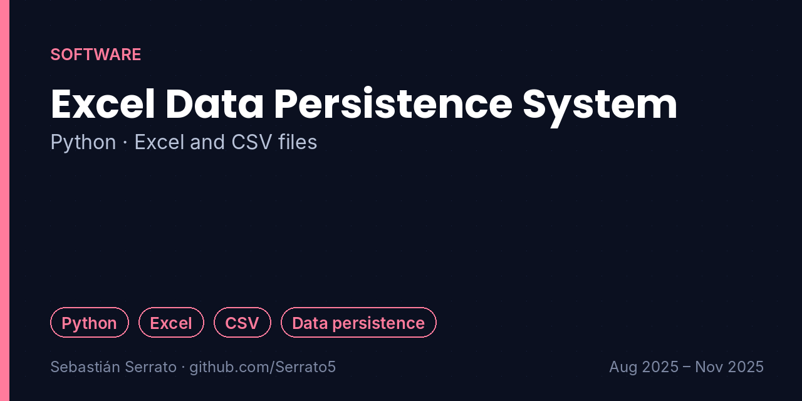

# Excel Data Persistence System

**Python · Excel and CSV files**

`Python` `Excel` `CSV` `Data persistence`

## Overview

A Python application for persisting and managing customer data in Excel and CSV files, with structured reading, writing and updating of records.

## Key features

- **Persistence:** Customer information stored in Excel and CSV files instead of only in memory.
- **Structured operations:** Reading, writing and updating of records in an organized way.
- **Practical focus:** Programming applied to a real data-management need.

## How it works

## What I learned

- Data that must survive the program needs persistence.
- Trade-offs between CSV (simple) and Excel (rich) formats.
- Organizing file operations so data stays consistent.

## Project context

| | |
|---|---|
| Context | Universidad Surcolombiana |
| Dates | Aug 2025 – Nov 2025 |
| Area | Software |

## Resumen en español

Aplicación en Python para guardar y administrar información de clientes en archivos Excel y CSV, con lectura, escritura y actualización estructurada de los registros.

---

**About this repository:** the original source code and design files of this project were not preserved. This repository documents what was built, how it works and what I learned, based on my project records. It does not contain reconstructed code.

**Sobre este repositorio:** el código y los archivos originales de este proyecto no se conservaron. Aquí se documenta qué se construyó, cómo funciona y qué aprendí, sin código reconstruido.

**Author:** Sebastián Serrato Ramírez · Electronic Engineering student, Universidad Surcolombiana (Neiva, Colombia) · [LinkedIn](https://www.linkedin.com/in/sebaserrato) · [More projects](https://github.com/Serrato5)
